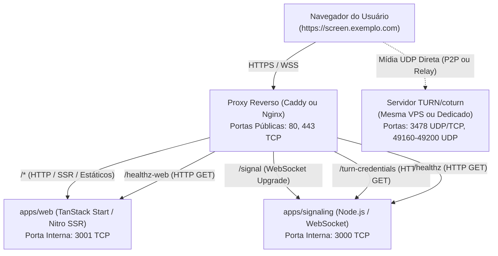

# Guia de Implantação e Operação em Servidor VPS (Linux)

Este documento estabelece o procedimento genérico para implantação, configuração e operação do **Janjalive** em qualquer servidor VPS Linux (Ubuntu, Debian ou distribuição compatível), sem dependência de plataformas proprietárias ou provedores de hospedagem específicos.

---

## 1. Visão Geral da Arquitetura de Produção

O Janjalive é composto por dois serviços desacoplados projetados para executar lado a lado no mesmo servidor, unificados sob o mesmo domínio público através de um **proxy reverso**:



### Mapeamento de Rotas sob a Mesma Origem

Para que as chamadas relativas do frontend funcionem sem erros de CORS, incompatibilidade de certificados ou roteamento falho, o proxy reverso deve expor as seguintes rotas no mesmo domínio:

| Rota da Requisição | Protocolo / Tipo | Serviço de Destino | Porta Interna Padrão |
|---|---|---|---|
| `/signal*` | WebSocket (`Upgrade: websocket`) | `apps/signaling` | `127.0.0.1:3000` |
| `/turn-credentials*` | HTTP GET | `apps/signaling` | `127.0.0.1:3000` |
| `/healthz` ou `/health` | HTTP GET | `apps/signaling` | `127.0.0.1:3000` |
| `/healthz-web` ou `/health-web` | HTTP GET | `apps/web` | `127.0.0.1:3001` |
| `/*` (todas as demais rotas) | HTTP GET / POST (SSR e estáticos) | `apps/web` | `127.0.0.1:3001` |

> [!IMPORTANT]
> A API nativa do navegador `navigator.mediaDevices.getDisplayMedia` e a negociação WebRTC exigem obrigatoriamente um contexto seguro (**HTTPS/TLS** ou `localhost`). O deploy de produção em VPS exige terminação TLS válida com certificado público.

---

## 2. Pré-requisitos da VPS Linux

### Recursos Recomendados do Sistema
- **Sistema Operacional:** Linux x86_64 moderno (Ubuntu 22.04 LTS / 24.04 LTS, Debian 12 ou similar).
- **Recursos mínimos:** 1 vCPU, 1 GB de RAM e 15 GB de disco (suficiente para tráfego WebRTC P2P leve, já que o servidor não processa vídeo diretamente).
- **Recursos recomendados:** 2 vCPUs, 2 GB de RAM (para compilação local mais rápida e múltiplos usuários simultâneos).
- **Acesso:** Acesso SSH com privilégios de `sudo`.
- **Domínio:** Um domínio ou subdomínio com registro DNS do tipo `A` apontando para o endereço IP público da VPS (ex.: `screen.exemplo.com`).

### Dependências de Sistema

Conforme a estratégia de execução escolhida (Nativa ou Docker), instale as ferramentas necessárias:

#### Para Execução Nativa via Node.js / pnpm:
- **Node.js:** Versão 22 LTS ou superior.
- **pnpm:** 12.6.0 (gerenciado via Corepack).
- **Git:** Para clonar e atualizar o repositório.
- **Compilador/Build Tools:** `build-essential` (se necessário para módulos nativos).

```bash
# Instalação do Node.js 22 LTS (exemplo Ubuntu/Debian via NodeSource)
curl -fsSL https://deb.nodesource.com/setup_22.x | sudo -E bash -
sudo apt-get install -y nodejs git

# Habilitar pnpm na versão exata do projeto (12.6.0)
sudo corepack enable
corepack prepare pnpm@12.6.0 --activate
```

#### Para Execução via Docker:
- **Docker Engine:** Versão 24 ou superior (`docker-ce`).
- **Git:** Para clonar o repositório.

```bash
# Instalação básica do Docker Engine (Ubuntu/Debian)
sudo apt-get update
sudo apt-get install -y ca-certificates curl gnupg git
sudo install -m 0755 -d /etc/apt/keyrings
curl -fsSL https://download.docker.com/linux/ubuntu/gpg | sudo gpg --dearmor -o /etc/apt/keyrings/docker.gpg
sudo chmod a+r /etc/apt/keyrings/docker.gpg
echo "deb [arch=$(dpkg --print-architecture) signed-by=/etc/apt/keyrings/docker.gpg] https://download.docker.com/linux/ubuntu $(. /etc/os-release && echo "$VERSION_CODENAME") stable" | sudo tee /etc/apt/sources.list.d/docker.list > /dev/null
sudo apt-get update && sudo apt-get install -y docker-ce docker-ce-cli containerd.io
```

---

## 3. Requisitos de Rede e Firewall

A integridade operacional da VPS depende da separação estrita entre portas acessíveis pela internet e portas restritas à máquina local.

### Portas Públicas e Portas Internas

| Porta | Protocolo | Escopo | Finalidade |
|---|---|---|---|
| **`22`** | TCP | Público | Acesso SSH administrativo (recomenda-se limitar por IP ou chave pública) |
| **`80`** | TCP | Público | HTTP para emissão/renovação de certificados ACME (Let's Encrypt) e redirecionamento para HTTPS |
| **`443`** | TCP | Público | HTTPS para tráfego web SSR e WSS (WebSocket seguro de sinalização) |
| **`3000`** | TCP | **Interno** | Serviço de sinalização (`apps/signaling`). **Não expor na internet.** |
| **`3001`** | TCP | **Interno** | Aplicação web TanStack Start (`apps/web`). **Não expor na internet.** |

> [!CAUTION]
> **Isolamento de Interfaces das Portas Internas (3000 e 3001):**
> - **Na execução nativa (Node.js/systemd):** Os processos devem ser configurados com `HOST=127.0.0.1`, vinculando-se diretamente à interface de loopback do host.
> - **Na execução via Docker:** Dentro do contêiner, os processos devem ouvir em `HOST=0.0.0.0` (para aceitar o tráfego encaminhado pela ponte de rede do Docker). No entanto, a publicação da porta no host deve ser restrita explicitamente ao loopback através do parâmetro `-p 127.0.0.1:3000:3000` (e `-p 127.0.0.1:3001:3001`), evitando a exposição involuntária em `0.0.0.0` no host.
>
> Se a porta `3000` for exposta publicamente na internet sem a intermediação do proxy reverso, a validação de origem (`ALLOWED_ORIGINS`) pode ser burlada por requisições diretas que forjem o cabeçalho `Host`.

### Exemplo de Configuração de Firewall com UFW

```bash
# Permitir SSH (ajuste a porta se usar porta personalizada)
sudo ufw allow 22/tcp comment 'SSH'

# Permitir tráfego web público
sudo ufw allow 80/tcp comment 'HTTP'
sudo ufw allow 443/tcp comment 'HTTPS'

# Se o servidor coturn estiver instalado NESTA MESMA VPS:
# sudo ufw allow 3478/tcp comment 'coturn TCP'
# sudo ufw allow 3478/udp comment 'coturn UDP'
# sudo ufw allow 49160:49200/udp comment 'coturn Media Relay'

# Ativar firewall
sudo ufw default deny incoming
sudo ufw default allow outgoing
sudo ufw enable
```

---

## 4. Variáveis de Ambiente

Configure as variáveis de ambiente antes de inicializar os serviços.

### 1. Serviço de Sinalização (`apps/signaling`)

| Variável | Obrigatória | Valor Padrão no Código | Descrição e Recomendações |
|---|---|---|---|
| `PORT` | Sim | `3000` | Porta TCP interna em que o servidor HTTP/WebSocket aguarda conexões. |
| `HOST` | Sim | `0.0.0.0` | Interface para bind. Recomenda-se `127.0.0.1` em modo nativo para isolamento local. |
| `ALLOWED_ORIGINS` | **Sim (em produção)** | Fallback para localhost | Lista separada por vírgulas de origens autorizadas (ex.: `https://screen.exemplo.com`). |
| `TURN_SECRET` | Opcional | `""` (vazio) | Segredo compartilhado HMAC-SHA1 compatível com coturn (`use-auth-secret`). |
| `TURN_SECRET_FILE` | Opcional | `/etc/screen-room/turn-secret` | Caminho no filesystem para o arquivo contendo a chave secreta. |
| `TURN_HOST` | Condicional | Obrigatório se TURN ativo | Hostname ou IP público do servidor coturn. **Obrigatório definir caso `TURN_SECRET` seja preenchido.** |
| `MAX_PARTICIPANTS_PER_ROOM` | Opcional | `10` | Limite operacional máximo de participantes simultâneos por sala (incluindo o apresentador). Fallback para `10`. |
| `TRUSTED_PROXIES` | Opcional | `127.0.0.1,::1,127.0.0.0/8` | Lista separada por vírgula de IPs ou faixas CIDR de proxies reversos confiáveis (ex.: `127.0.0.1,172.17.0.1,172.16.0.0/12`). Essencial em contêineres Docker atrás de proxy no host. |

> [!WARNING]
> - **Formatação de `ALLOWED_ORIGINS`:** Use origens completas, como `https://screen.exemplo.com`, com esquema e porta quando necessária, sem caminhos. A configuração é normalizada pelo servidor antes da comparação; confira a origem pública efetiva ao investigar respostas `403 Forbidden`.
> - **Definição de `TURN_HOST`:** Se `TURN_SECRET` estiver configurado, sempre forneça `TURN_HOST` explicitamente com o endereço do seu coturn. Caso ausente quando um segredo for definido, o servidor de sinalização falhará imediatamente na inicialização (CFG-01).

### 2. Serviço Web e SSR (`apps/web`)

| Variável | Obrigatória | Valor Padrão no Código | Descrição e Recomendações |
|---|---|---|---|
| `PORT` | Sim | `3001` | Porta TCP interna do runtime Nitro / TanStack Start. |
| `HOST` | Sim | `0.0.0.0` | Interface para bind. Recomenda-se `127.0.0.1` em modo nativo. |
| `NODE_ENV` | Sim | `production` | Define otimizações de produção e desativa o modo de demonstração. |

---

## 5. Configuração do Proxy Reverso com TLS

Escolha uma das opções abaixo para gerenciar a terminação TLS e o encaminhamento sob a mesma origem.

### Opção 1: Caddy (Recomendado pela simplicidade)

O Caddy gerencia automaticamente a emissão e renovação de certificados Let's Encrypt / ZeroSSL, com suporte nativo transparente a WebSockets.

Instalação no Ubuntu/Debian:
```bash
sudo apt-get install -y debian-keyring debian-archive-keyring apt-transport-https curl
curl -1sLf 'https://dl.cloudsmith.io/public/caddy/stable/gpg.key' | sudo gpg --dearmor -o /usr/share/keyrings/caddy-stable-archive-keyring.gpg
curl -1sLf 'https://dl.cloudsmith.io/public/caddy/stable/debian.deb.txt' | sudo tee /etc/apt/sources.list.d/caddy-stable.list
sudo apt-get update && sudo apt-get install -y caddy
```

Arquivo de configuração `/etc/caddy/Caddyfile`:
```caddy
screen.exemplo.com {
    # 1. Sinalização WebSocket (/signal) -> apps/signaling
    handle /signal* {
        reverse_proxy 127.0.0.1:3000 {
            header_up X-Real-IP {remote_host}
        }
    }

    # 2. Credenciais efêmeras TURN -> apps/signaling
    handle /turn-credentials* {
        reverse_proxy 127.0.0.1:3000 {
            header_up X-Real-IP {remote_host}
        }
    }

    # 3. Verificação de integridade do signaling (/healthz e /health) -> apps/signaling
    # Utiliza matcher exato de paths para evitar interceptar /healthz-web do serviço web
    @signaling_health path /healthz /health
    handle @signaling_health {
        reverse_proxy 127.0.0.1:3000
    }

    # 4. Interface Web, SSR e Health Check do Web (/healthz-web) -> apps/web
    handle {
        reverse_proxy 127.0.0.1:3001 {
            header_up X-Real-IP {remote_host}
        }
    }
}
```

Recarregar configuração:
```bash
sudo systemctl reload caddy
```

---

### Opção 2: Nginx

Instalação no Ubuntu/Debian:
```bash
sudo apt-get install -y nginx certbot python3-certbot-nginx
```

Arquivo de configuração `/etc/nginx/sites-available/screen-room`:
```nginx
map $http_upgrade $connection_upgrade {
    default upgrade;
    ''      close;
}

server {
    listen 80;
    listen [::]:80;
    server_name screen.exemplo.com;

    # Redirecionamento HTTP para HTTPS
    return 301 https://$host$request_uri;
}

server {
    listen 443 ssl http2;
    listen [::]:443 ssl http2;
    server_name screen.exemplo.com;

    # Certificados SSL (gerados pelo certbot)
    ssl_certificate /etc/letsencrypt/live/screen.exemplo.com/fullchain.pem;
    ssl_certificate_key /etc/letsencrypt/live/screen.exemplo.com/privkey.pem;

    # Configurações de segurança TLS recomendadas
    ssl_protocols TLSv1.2 TLSv1.3;
    ssl_ciphers HIGH:!aNULL:!MD5;
    ssl_prefer_server_ciphers on;

    # 1. Sinalização WebSocket
    location /signal {
        proxy_pass http://127.0.0.1:3000;
        proxy_http_version 1.1;
        proxy_set_header Upgrade $http_upgrade;
        proxy_set_header Connection $connection_upgrade;
        proxy_set_header Host $host;
        proxy_set_header X-Real-IP $remote_addr;
        proxy_set_header X-Forwarded-For $proxy_add_x_forwarded_for;
        proxy_set_header X-Forwarded-Proto $scheme;

        # Timeout estendido essencial para conexões persistentes WebSocket
        proxy_read_timeout 86400s;
        proxy_send_timeout 86400s;
    }

    # 2. Credenciais TURN e Health Check do Signaling
    # Delimitador (/|$) evita captura indevida de /healthz-web ou /health-web do serviço web
    location ~ ^/(turn-credentials|healthz|health)(/|$) {
        proxy_pass http://127.0.0.1:3000;
        proxy_http_version 1.1;
        proxy_set_header Host $host;
        proxy_set_header X-Real-IP $remote_addr;
        proxy_set_header X-Forwarded-For $proxy_add_x_forwarded_for;
        proxy_set_header X-Forwarded-Proto $scheme;
    }

    # 3. Frontend Web TanStack Start (SSR, Assets estáticos e /healthz-web)
    location / {
        proxy_pass http://127.0.0.1:3001;
        proxy_http_version 1.1;
        proxy_set_header Host $host;
        proxy_set_header X-Real-IP $remote_addr;
        proxy_set_header X-Forwarded-For $proxy_add_x_forwarded_for;
        proxy_set_header X-Forwarded-Proto $scheme;
    }
}
```

Ativar site e gerar certificado com Certbot:
```bash
sudo ln -sf /etc/nginx/sites-available/screen-room /etc/nginx/sites-enabled/
sudo nginx -t
sudo certbot --nginx -d screen.exemplo.com
sudo systemctl reload nginx
```

> [!TIP]
> A diretiva `proxy_read_timeout 86400s;` no bloco `/signal` é fundamental para evitar que o Nginx encerre silenciosamente o WebSocket de participantes inativos após o timeout padrão de 60 segundos.

### 5.3. Resolução Segura de IP e Contrato de Proxy (OPS-02)

Para proteger a obtenção de credenciais TURN (`/turn-credentials`) contra esgotamento de taxa (rate limiting de 60 req/min por IP), o servidor de sinalização implementa resolução determinística de IP cliente:

1. **Validação da Origem TCP (`TRUSTED_PROXIES`):**
   - O servidor inspeciona a conexão TCP física (`req.socket.remoteAddress`).
   - Se a conexão física **NÃO pertencer** à lista de proxies confiáveis (`TRUSTED_PROXIES`, por padrão `127.0.0.1,::1,127.0.0.0/8`), quaisquer cabeçalhos `X-Forwarded-For` ou `X-Real-IP` são **completamente ignorados**, utilizando-se estritamente o endereço TCP. Isso neutraliza tentativas externas de forjar cabeçalhos para manipular buckets de rate limit.
   - Em contêineres Docker atrás de um proxy no host ou em outro contêiner, o operador deve configurar `TRUSTED_PROXIES` com o IP do gateway ou faixa da rede Docker (ex.: `TRUSTED_PROXIES=127.0.0.1,172.17.0.1,172.16.0.0/12`). O servidor **não confia automaticamente em todas as redes privadas** para evitar aberturas indevidas.

2. **Cadeia de Encaminhamento e Precedência:**
   - **Contrato A (`X-Real-IP`):** Quando a conexão TCP provém de um proxy confiável e `X-Real-IP` está presente, seu valor é validado (`net.isIP`) e adotado com precedência. O Caddy (`header_up X-Real-IP {remote_host}`) e o Nginx (`proxy_set_header X-Real-IP $remote_addr;`) sobrescrevem esse cabeçalho na borda, garantindo imunidade a spoofing.
   - **Contrato B (`X-Forwarded-For`):** O servidor percorre a cadeia da direita para a esquerda (do hop mais próximo ao servidor em direção à origem) e seleciona o primeiro endereço que não seja um proxy confiável. Isso impede que atacantes que injetam valores falsos à esquerda consigam burlar a identificação de IP.

> [!NOTE]
> **Compartilhamento de IP em Redes Locais (NAT):**
> Clientes corporativos ou em uma mesma rede Wi-Fi que compartilham o mesmo IP público de saída compartilharão a mesma cota de 60 req/min de `/turn-credentials`. Em salas com até 10 participantes, isso é perfeitamente suficiente (10 requisições simultâneas consomem apenas 16% da cota por minuto).

---

### 5.4. Identidade de Reconexão e Credencial Efêmera (SEC-03)

Para evitar substituições indevidas de participantes e negações de serviço direcionadas em salas de até 10 pessoas, o protocolo adota credenciais efêmeras de sessão:

1. **Geração e Entrega Confidencial:**
   - No primeiro ingresso válido (`join`), o servidor gera um `reconnectToken` criptograficamente imprevisível (`crypto.randomUUID()`) e o associa em memória ao participante na sala (`RoomRegistry`).
   - O token é entregue exclusivamente ao próprio cliente na mensagem privada `{ type: 'peers', ..., reconnectToken }`.
   - As mensagens de presença (`peer-joined`, `peer-left`, `peer-updated`) e os logs de sinalização **nunca divulgam** o token.

2. **Substituição e Proteção de Sessão Ativa:**
   - Quando uma nova conexão WebSocket envia `join` para um `peerId` que já possui sessão ativa na sala:
     - **Com token válido:** A nova conexão substitui o socket anterior, que é fechado de forma limpa com código `4000` (`WS_CLOSE_CODES.SUPERSEDED`).
     - **Sem token ou com token inválido:** A conexão concorrente ou hostil é rejeitada com erro `{ type: 'error', code: 'UNAUTHORIZED_RECONNECT' }` e seu socket é encerrado com código terminal `4401` (`WS_CLOSE_CODES.UNAUTHORIZED_RECONNECT`). A sessão legítima do participante permanece conectada e inalterada.

3. **Ciclo de Vida Efêmero e Códigos de Fechamento:**
   - O servidor mantém o token em memória. O cliente o guarda no `sessionStorage` da aba, isolado por sala, junto das credenciais de sessão; não o inclua em convites ou logs. Não há armazenamento em `localStorage`, cookies ou banco de dados.
   - Quando o participante sai definitivamente (`signaling.disconnect()`) ou a sala é encerrada, o registro e o token são destruídos imediatamente, liberando a vaga.
   - Os códigos `4000` (`SUPERSEDED`), `4401` (`UNAUTHORIZED_RECONNECT`), `4009` (`ROOM_FULL`) e `4403` (`FORBIDDEN_ORIGIN`) são exemplos de encerramentos terminais (`isTerminalCloseCode`); a lista atual está em `packages/protocol/src/messages.ts` e no [guia de diagnóstico](DEBUG.md#encerramentos-websocket). Quando recebidos, o cliente desativa o reagendamento automático de conexão, evitando loops infinitos de reconexão.

---

## 6. Alternativas de Execução dos Serviços

Escolha uma das alternativas para compilar e iniciar os serviços na VPS.

### Alternativa A: Execução Nativa via Node.js e pnpm

Esta abordagem executa os serviços diretamente no sistema operacional.

#### 1. Obtenção do Código e Compilação
```bash
cd /opt
sudo git clone https://github.com/aldomigge/webrtc-shared.git screen-room
cd screen-room
sudo chown -R $USER:$USER /opt/screen-room

# Instalação com congelamento de lockfile
pnpm install --frozen-lockfile

# Compilação recursiva de todos os pacotes e aplicações
pnpm build
```

#### 2. Execução dos Serviços via Gerenciador de Processos (Exemplo com systemd)

Crie duas unidades de serviço no systemd para gerenciar a inicialização e o reinício automático:

> [!NOTE]
> O caminho `/usr/bin/node` indicado nas diretivas `ExecStart` abaixo é exemplificativo. Como o systemd exige caminhos absolutos para executáveis, identifique o caminho real do binário do Node.js instalado na VPS com:
> ```bash
> command -v node
> ```
> Utilize o caminho absoluto retornado (ex.: `/usr/bin/node`, `/usr/local/bin/node` ou caminho gerenciador) no parâmetro `ExecStart` de cada unidade.

**Serviço do Signaling (`/etc/systemd/system/screen-room-signaling.service`):**
```ini
[Unit]
Description=Janjalive - Signaling Service
After=network.target

[Service]
Type=simple
User=www-data
WorkingDirectory=/opt/screen-room/apps/signaling
Environment=NODE_ENV=production
Environment=PORT=3000
Environment=HOST=127.0.0.1
Environment=ALLOWED_ORIGINS=https://screen.exemplo.com
# Opcional (se utilizar TURN com coturn):
# Environment=TURN_SECRET=sua_chave_secreta_aqui
# Environment=TURN_HOST=turn.exemplo.com
ExecStart=/usr/bin/node dist/index.js
Restart=always
RestartSec=5
StandardOutput=journal
StandardError=journal

[Install]
WantedBy=multi-user.target
```

**Serviço Web (`/etc/systemd/system/screen-room-web.service`):**
```ini
[Unit]
Description=Janjalive - Web SSR Application
After=network.target screen-room-signaling.service

[Service]
Type=simple
User=www-data
WorkingDirectory=/opt/screen-room/apps/web
Environment=NODE_ENV=production
Environment=PORT=3001
Environment=HOST=127.0.0.1
ExecStart=/usr/bin/node .output/server/index.mjs
Restart=always
RestartSec=5
StandardOutput=journal
StandardError=journal

[Install]
WantedBy=multi-user.target
```

Ativar e iniciar ambos os serviços:
```bash
sudo systemctl daemon-reload
sudo systemctl enable --now screen-room-signaling
sudo systemctl enable --now screen-room-web
```

---

### Alternativa B: Execução via Docker

Esta abordagem isola as dependências dentro dos contêineres construídos a partir dos Dockerfiles oficiais do monorepo.

#### 1. Construção das Imagens Docker
A partir da raiz do repositório:
```bash
cd /opt/screen-room

# 1. Build da imagem do serviço de sinalização
docker build -f apps/signaling/Dockerfile -t screen-room-signaling:latest .

# 2. Build da imagem da aplicação web
docker build -f apps/web/Dockerfile -t screen-room-web:latest .
```

#### 2. Inicialização dos Contêineres
Inicie ambos os contêineres publicando suas portas **estritamente na interface local (`127.0.0.1`)**:

> [!NOTE]
> **Atenção ao bind de rede:** Dentro dos contêineres, `-e HOST=0.0.0.0` permite que os processos atendam ao tráfego direcionado pela ponte virtual do Docker. No host, o prefixo `-p 127.0.0.1:porta:porta` restringe a escuta exclusivamente à interface de loopback da VPS, impedindo acesso externo direto às portas dos contêineres.

```bash
# Iniciar o container de sinalização
docker run -d \
  --name screen-room-signaling \
  --restart unless-stopped \
  -p 127.0.0.1:3000:3000 \
  -e PORT=3000 \
  -e HOST=0.0.0.0 \
  -e ALLOWED_ORIGINS="https://screen.exemplo.com" \
  screen-room-signaling:latest

# Iniciar o container web
docker run -d \
  --name screen-room-web \
  --restart unless-stopped \
  -p 127.0.0.1:3001:3001 \
  -e PORT=3001 \
  -e HOST=0.0.0.0 \
  -e NODE_ENV=production \
  screen-room-web:latest
```

> [!NOTE]
> Se desejar ativar o TURN no container de sinalização, adicione as variáveis correspondentes no comando do signaling:
> `-e TURN_SECRET="sua_chave_secreta" -e TURN_HOST="turn.exemplo.com"`

---

## 7. Integração com Servidor TURN / Coturn

O Janjalive opera primariamente em conexões P2P diretas via STUN público do Google. Contudo, em redes com NAT simétrico ou firewalls restritivos, um servidor TURN é indispensável para evitar falhas de conexão ICE.

### Independência de Hospedagem
O servidor `coturn` **não precisa estar na mesma VPS** do Janjalive:
- Pode ser instalado na mesma VPS Linux;
- Pode estar hospedado em uma VPS dedicada;
- Pode ser um serviço gerenciado de relay compatível com o mecanismo de credenciais efêmeras baseadas em timestamp (`use-auth-secret`).

### Requisitos de Rede do Coturn
O tráfego de sinalização TURN e a retransmissão de mídia exigem a liberação das seguintes portas no firewall da máquina onde o `coturn` estiver hospedado:
- **Porta de Sinalização e Alocação STUN/TURN (3478):**
  - **`3478/UDP`:** Protocolo preferencial para STUN e alocação TURN (menor latência e sem sobrecarga de retransmissão TCP).
  - **`3478/TCP`:** Alternativa de contingência para clientes em redes restritivas cujo firewall corporativo bloqueie tráfego UDP de saída.
- **Faixa de Portas de Relay de Mídia (49160–49200):**
  - **`49160–49200/UDP`:** Faixa de portas dinâmicas para transporte direto dos fluxos de áudio e vídeo retransmitidos (deve coincidir com os parâmetros `min-port` e `max-port` no `turnserver.conf`).

> [!IMPORTANT]
> O tráfego de mídia UDP das portas 3478 e 49160–49200 **não passa pelo proxy reverso HTTP** nem por túneis como Cloudflare Tunnel. Essas portas devem estar diretamente abertas no firewall público da máquina onde o `coturn` estiver em execução.

### Paridade de Chave Compartilhada
Para que o endpoint `/turn-credentials` emita senhas temporárias aceitas pelo coturn:
1. No arquivo de configuração do coturn (`/etc/turnserver.conf`):
   ```conf
   use-auth-secret
   static-auth-secret=CHAVE_COMPARTILHADA_FORTE_AQUI
   realm=screen.exemplo.com
   ```
2. No ambiente do `apps/signaling`:
   ```bash
   TURN_SECRET="CHAVE_COMPARTILHADA_FORTE_AQUI"
   TURN_HOST="endereco-ip-ou-dominio-do-turn"
   ```

---

## 8. Verificação e Testes Pós-Deploy

Após concluir a inicialização dos serviços e a configuração do proxy reverso, execute os seguintes testes diagnósticos:

### 1. Verificação das Portas Locais na VPS
Confirme se os dois processos estão ativos e ouvindo nas portas internas esperadas:
```bash
# Verificar portas em escuta (3000 e 3001)
ss -tulpn | grep -E ':(3000|3001)'
```

### 2. Teste Direto dos Endpoints Internos
```bash
# Health check do signaling interno (esperado HTTP 200)
curl -s http://127.0.0.1:3000/healthz
# Resposta esperada: {"status":"ok","service":"signaling"}

# Health check do serviço web interno (esperado HTTP 200)
curl -s http://127.0.0.1:3001/healthz-web
# Resposta esperada: {"status":"ok","service":"web"}

# Resposta do serviço web interno (esperado HTTP 200 com HTML SSR)
curl -sI http://127.0.0.1:3001/ | grep "HTTP/"
# Resposta esperada: HTTP/1.1 200 OK
```

### 3. Teste dos Endpoints Públicos via Domínio
Execute estes testes a partir da sua máquina local ou do próprio servidor:

```bash
# 1. Health check público do signaling através do proxy
curl -s https://screen.exemplo.com/healthz
# Esperado: {"status":"ok","service":"signaling"}

# 2. Health check público do serviço web através do proxy
curl -s https://screen.exemplo.com/healthz-web
# Esperado: {"status":"ok","service":"web"}

# 3. Requisição de credenciais TURN com cabeçalho Origin autorizado
curl -s -H "Origin: https://screen.exemplo.com" https://screen.exemplo.com/turn-credentials
# Esperado: JSON contendo "iceServers" com HTTP 200

# 4. Teste de rejeição de origem não autorizada
curl -sI -H "Origin: https://site-malicioso.com" https://screen.exemplo.com/turn-credentials | grep "HTTP/"
# Esperado: HTTP/1.1 403 Forbidden
```

### 4. Validação no Navegador
1. Acesse `https://screen.exemplo.com` em um navegador.
2. Crie uma sala ou entre em um link (`/room/:roomId`).
3. Abra **Configurações** -> **Rede & Métricas** -> **Eventos técnicos** e confirme:
   - Registro `signal-open` ou `signal-connecting` concluído com sucesso;
   - Registro `turn-config` indicando a quantidade de servidores ICE recebidos;
   - Inicie o compartilhamento de tela e confira a transição de `pc-ice` para `connected`.

> [!NOTE]
> **Health Checks Dedicados dos Serviços:**
> - **Serviço Web (`apps/web`):** Possui o endpoint dedicado `/healthz-web` (e alias `/health-web`), que responde imediatamente com `{"status":"ok","service":"web"}` em HTTP 200 sem renderizar a árvore de componentes SSR do React. Ferramentas de monitoramento externo (uptime probes, load balancers) devem consultar `/healthz-web`.
> - **Serviço de Sinalização (`apps/signaling`):** Possui o endpoint dedicado `/healthz` (e alias `/health`), que responde com `{"status":"ok","service":"signaling"}` em HTTP 200.

---

## 9. Procedimento Básico de Atualização e Reinicialização

Quando novas alterações forem promovidas para a branch principal:

### Para Instalação Nativa:
```bash
cd /opt/screen-room

# 1. Atualizar código
git pull origin main

# 2. Atualizar dependências e recompilar
pnpm install --frozen-lockfile
pnpm build

# 3. Reiniciar os serviços
sudo systemctl restart screen-room-signaling
sudo systemctl restart screen-room-web

# 4. Verificar status
sudo systemctl status screen-room-signaling --no-pager
sudo systemctl status screen-room-web --no-pager
```

### Para Instalação via Docker:
```bash
cd /opt/screen-room

# 1. Atualizar código
git pull origin main

# 2. Reconstruir as imagens
docker build -f apps/signaling/Dockerfile -t screen-room-signaling:latest .
docker build -f apps/web/Dockerfile -t screen-room-web:latest .

# 3. Reiniciar os contêineres
docker stop screen-room-signaling && docker rm screen-room-signaling
docker stop screen-room-web && docker rm screen-room-web

docker run -d --name screen-room-signaling --restart unless-stopped \
  -p 127.0.0.1:3000:3000 -e PORT=3000 -e HOST=0.0.0.0 \
  -e ALLOWED_ORIGINS="https://screen.exemplo.com" screen-room-signaling:latest

docker run -d --name screen-room-web --restart unless-stopped \
  -p 127.0.0.1:3001:3001 -e PORT=3001 -e HOST=0.0.0.0 \
  -e NODE_ENV=production screen-room-web:latest
```

---

## 10. Compatibilidade e recuperação

Web, signaling e protocol devem usar contratos compatíveis. Atualize os serviços em conjunto e recarregue clientes antigos ao validar uma atualização; abas antigas não devem ser presumidas compatíveis com mudanças de protocolo.

Reiniciar o signaling elimina salas, reservas e autoridades administrativas em memória. Informe os participantes antes de uma manutenção. Uma queda involuntária reserva identidade e vaga por 30 segundos; saída voluntária libera ambas imediatamente. A presença conta conectados, enquanto a capacidade considera conectados mais reservas.

Antes de concluir uma publicação, siga as verificações da seção 8 e os procedimentos de [diagnóstico](DEBUG.md). Confirme captura, primeiro frame, parada/reinício, entrada tardia, múltiplos apresentadores e reconexão; valide áudio e webcam opcionais separadamente. Exercite dispositivos/redes distintos e [relay obrigatório](TURN.md#validação-do-caminho-relay). Testes locais sintéticos não substituem essa validação.
