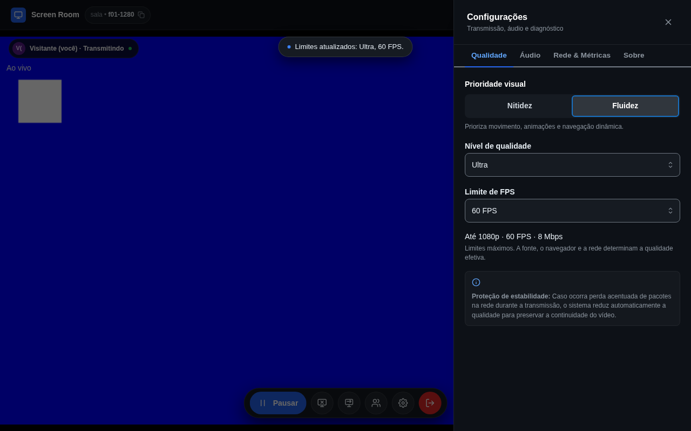
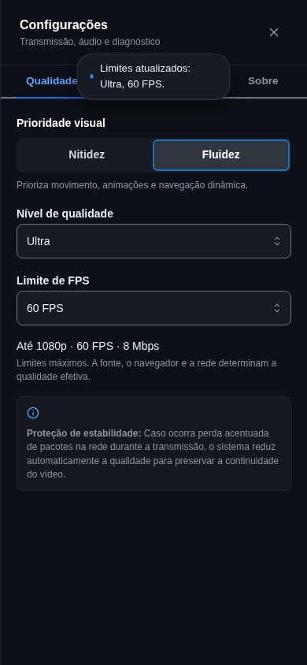

# Validação F01 + F02

Ambiente: Node 22.23.3, pnpm 12.6.0, Linux, Chromium 156.0.8078.4 (Playwright). Base: `55c9cf4288cb80102ee60d0296c43b0a47079a8b`. Sem dependências adicionais, alteração da sinalização, merge ou deploy.

## Implementação e arquivos

- `packages/protocol/src/quality.ts`: matriz, padrão, normalização de transições, parâmetros derivados e downgrade.
- `apps/web/src/features/room/media/display-media.ts`: envelope nativo, registro imediato de ownership para limpeza, limites da track, hints, verificação e fila por track.
- `apps/web/src/features/room/webrtc/peer-manager.ts`: limites em todos os encodings de vídeo, preferência de degradação e fallback, fila de qualidade e barreiras por peer. Aplicação tanto ao oferecer como ao responder.
- `apps/web/src/features/room/hooks/useRoomSession.ts`: seleção, feedback, atualização de prévias e capturas pendentes, preservação de gerações e diagnóstico da captura.
- `apps/web/src/features/room/stats/stats-collector.ts`: gatilho por pior intervalo de envio, sem confundir outro apresentador recebido; FPS, dimensões e bitrate por direção no diagnóstico.
- `apps/web/src/features/room/components/SettingsDrawer.tsx`: prioridade, perfil, FPS válidos e resumo de tetos; mantém os demais painéis.
- `apps/web/src/routes/room.$roomId.tsx`: texto da demonstração coerente com o modelo novo.
- `apps/web/tsconfig.json`: imports TypeScript explícitos permitidos em verificação sem emissão, para compartilhar o helper também nos testes Node.
- Testes em `packages/protocol/test/{protocol,quality}.test.js`, `apps/web/test/{media,peer-manager,stats-collector}.test.js` e `apps/web/e2e/sharing.spec.ts`.
- `PERFORMANCE.md`, referências diretamente afetadas em `README.md`/`DEBUG.md` e estes artefatos de validação.

## Matriz implementada

| Perfil | Nitidez: resolução / FPS / Mbps | Fluidez: resolução / FPS / Mbps |
|---|---|---|
| Econômico | até 720p / 20 ou 30 / 1,6 | até 720p / 30 / 2 |
| Equilibrado | até 1080p / 20 ou 30 / 3 | até 720p / 30 ou 60 / 4 |
| Ultra | até 1440p / 20 ou 30 / 6 | até 1080p / 30 ou 60 / 8 |

Padrão: Nitidez, Equilibrado, 20 FPS. Hints `text`/`motion` e preferências `maintain-resolution`/`maintain-framerate` distinguem tecnicamente as prioridades. Os valores são limites, sujeitos a capacidades e ao comportamento do navegador.

## Verificações automatizadas

- `pnpm --filter @screen-room/signaling... build`: preparação de protocol e signaling aprovada.
- `pnpm build`: aprovado; avisos existentes de diretivas `use client` de dependências Mantine no bundle, sem erro de compilação.
- `pnpm typecheck`: aprovado.
- `pnpm test`: 140 testes aprovados (9 protocol, 65 signaling, 66 web).
- `pnpm --filter @screen-room/web test:e2e`: 52 aprovados em 2,4 minutos na execução final, sem build ou medição nativa concorrentes.
- Impeccable: contexto local aplicado ao refinamento; detector da gaveta retornou `[]`.

Um teste de regressão reproduziu resposta de peer removido enquanto parâmetros aguardavam (vermelho antes, verde após a guarda de identidade depois do await). Ofertas e respostas conferem novamente a identidade do peer antes de sinalizar.

Os testes novos cobrem matriz e parâmetros, padrão, normalização, downgrade, constraints e hints, capacidade inferior, propriedades ausentes, rejeição, concorrência, múltiplos senders, entrada tardia, resposta a oferta, substituição da fonte, áudio mutado e desanexação. A proteção é testada com perdas de envio e recepção simultâneas, relatórios repetidos e contadores reiniciados. Os E2E novos verificam seleção por teclado, opções válidas, limites retornados por senders reais, ausência de recaptura por qualidade, pausa/retomada, troca confirmada e saída da sessão enquanto constraints iniciais ainda estão pendentes.

A suíte existente cobre ciclos de compartilhamento, entrada tardia de nove espectadores, reconexão, múltiplos apresentadores, prévia, cancelamento e falhas da troca, limpeza, áudio e gerações F27. A fonte destes E2E é sintética (canvas/Web Audio); a negociação, os senders, a codificação e a recepção WebRTC são reais no navegador local.

### Intercorrências

A primeira execução teve falha na contagem de sockets do teste de áudio (5 em vez de 1), timeout de `old-ended` e timeout em um teste novo que tentava clicar diretamente no input visualmente oculto do SegmentedControl. A execução coincidiu com edição/build do servidor Vite. O teste novo foi corrigido para acionar o rótulo visível. Uma repetição focada, com arquivos estáveis, passou nos quatro testes, incluindo desktop/mobile, áudio e `old-ended`. Não há comparação suficiente com a base para classificar os dois primeiros casos como falhas preexistentes. Outra rodada completa teve 50 aprovações e timeout de 5 segundos esperando frames em um dos nove espectadores, enquanto a captura nativa 1440p/60 e loopback estavam sendo medidos em paralelo. O cenário passou na repetição sem carga concorrente. A coincidência não comprova causalidade nem falha preexistente; não foi aumentado o timeout para ocultá-la. Execuções interrompidas para corrigir o envelope nativo e a limpeza durante constraints não contam como aprovação da suíte.

## Captura nativa e medições locais

[Dados completos da rodada final](f01-f02-native.json). Reproduzir com web Vite em `http://127.0.0.1:4311` e ambiente gráfico:

```sh
pnpm --filter @screen-room/web exec vite dev --host 127.0.0.1 --port 4311
# Em outro terminal:
node docs/validation/native-quality.mjs
```

O script captura exclusivamente uma aba gerada por ele, por título, usando `getDisplayMedia()` nativo e seleção automática de teste do Chromium. A fonte tem código pequeno (12px) e um canvas com movimento contínuo via requestAnimationFrame. Ele aplica o helper real de captura e transmite a track por dois RTCPeerConnections locais, com limites de sender equivalentes aos da matriz. Não usa captura sintética nem captura da tela pessoal. A seleção automática não valida o uso manual do seletor/permissões do sistema.

A primeira tentativa de selecionar a própria aba controladora terminou em timeout. Capturar uma segunda aba dedicada funcionou. A investigação também mostrou que `ideal: 20` na seleção inicial fixa a capacidade nativa em 20 neste Chromium, mesmo com `max: 60`. Por isso, o aplicativo solicita envelope nativo de 60 e aplica o teto escolhido **antes de retornar para a prévia**. Na rodada final, a captura padrão retornou 1920×1080 a 20 e manteve capacidade 60; as seis combinações seguintes foram aplicadas na mesma track, sem reabrir o seletor.

| Seleção | Captura (`getSettings`) | FPS codificado | FPS recebido | Bitrate medido de vídeo |
|---|---|---:|---:|---:|
| Nitidez Econômico 20 | 1280×720, limite 20 | 19 | 19 | ~481 kbps |
| Nitidez Equilibrado 30 | 1920×1080, limite 30 | 30 | 30 | ~1075 kbps |
| Nitidez Ultra 30 | 2560×1440, limite 30 | 31 | 31 | ~1800 kbps |
| Fluidez Econômico 30 | 1280×720, limite 30 | 30 | 30 | ~670 kbps |
| Fluidez Equilibrado 60 | 1280×720, limite 60 | 53 | 53 | ~653 kbps |
| Fluidez Ultra 60 | 1920×1080, limite 60 | 42 | 42 | ~1749 kbps |

Samples curtos (~1,8 s por configuração); `framesPerSecond` é estatística do navegador e pode refletir a janela anterior ou arredondamento nas transições. Bitrate usa delta de bytes/timestamp, sem overhead de transporte. Esses samples comprovam captura nativa, alteração de resolução/FPS e codificação/decodificação locais; não comprovam 60 FPS sustentados, melhoria perceptual da leitura ou desempenho em redes congestionadas.

## Interface

Desktop 1280×800 e mobile 390×844 foram inspecionados visualmente. Prioridade usa rádio nativo com foco e setas; perfil e FPS usam selects nativos rotulados; resumo anuncia mudanças. Selects têm 44px de altura e o segmento tem área total de aproximadamente 44px, incluindo padding. Os screenshots mostram Fluidez Ultra 60 e o feedback temporário de atualização. A suíte também mantém as verificações existentes de prévia/dock em 320px, tablet e paisagem e de navegação por toque no zoom. O segmento também foi acionado por `tap()` no contexto mobile. Não houve teste em aparelho físico nem leitor de tela.





## Limitações e riscos

- Sem teste de áudio nativo da aba/sistema, autoplay nativo ou permissão manual do sistema operacional.
- Sem ensaio entre redes distintas, STUN/TURN real, saturação de upload, CPU ou teste prolongado. Ultra em mesh pode exigir até 54/72 Mbps de vídeo somado com nove espectadores.
- Chromium foi o navegador medido nativamente. Compatibilidade de Firefox/Safari depende de suporte às APIs; propriedades ausentes, rejeições e falhas parciais têm cobertura por mocks, sem garantia de equivalência entre navegadores.
- Falhas de constraints preservam a captura; falhas da preferência de degradação tentam novamente os limites sem a preferência. Aplicação parcial não é anunciada como sucesso integral. Configuração solicitada, settings e estatísticas efetivas permanecem distintas.
- Hints, bitrate máximo e preferências de degradação não garantem comportamento do encoder nem nitidez/fluidez percebida. Não há recuperação automática de qualidade.
- Nenhuma decisão adicional de produto, arquitetura ou infraestrutura foi necessária.
